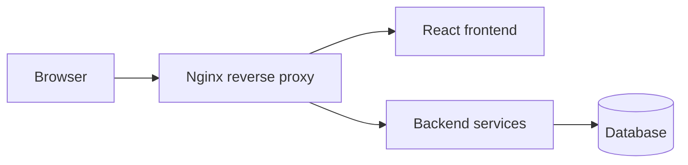

# StudyFlow

A containerized student portal for Manipal University Jaipur (MUJ) students. StudyFlow brings university websites, student-hosted sites, and everyday campus tools into a single dashboard, so students stop juggling a dozen bookmarks and logins.

[Live Demo](YOUR_LIVE_URL)

> The application source code is kept private. This repository documents the architecture and the sanitized infrastructure setup: Dockerfiles, Docker Compose, and the Nginx config. Source access is available on request.

---

## The Problem

MUJ students use many separate sites and tools: university portals, club and student-hosted websites, notes shared over chat, forums, class schedules, and mess menus. StudyFlow puts them behind one dashboard.

## Features

- Unified dashboard linking university websites and student-hosted sites
- Notes sharing
- Discussion forum
- Class manager
- Mess manager
- Fully containerized, runs with a single command

## Architecture



Nginx is the single entry point. It serves the React build and proxies API requests to the backend services. Every component runs in its own container, so the same images run locally or on any Docker-capable host.

## Tech Stack

| Layer | Technology |
|-------|------------|
| Frontend | React.js, Tailwind CSS |
| Reverse proxy | Nginx |
| Containerization | Docker, Docker Compose |
| Hosting | Vercel |
| Version control | Git, GitHub |

## Repository Layout

```
studyflow-infra/
├── docker/
│   ├── frontend.Dockerfile
│   ├── backend.Dockerfile
│   └── nginx.conf
├── docker-compose.yml
├── docker-compose.dev.yml
├── .env.example
└── README.md
```

## Quick Start with Docker Compose

Prerequisites: Docker and Docker Compose installed.

```bash
git clone https://github.com/JaiSachdevaa/studyflow-infra.git
cd studyflow-infra
cp .env.example .env
docker compose up --build
```

Open `http://localhost` in your browser.

For the development configuration with separate environment files:

```bash
docker compose -f docker-compose.yml -f docker-compose.dev.yml up --build
```

Stop everything:

```bash
docker compose down
```

## Environment Variables

Copy `.env.example` to `.env` and fill in your own values. Never commit the real `.env` file.

| Variable | Description |
|----------|-------------|
| `FRONTEND_PORT` | Host port for the Nginx entry point |
| `BACKEND_PORT` | Internal port of the backend service |
| `API_URL` | Base URL the frontend uses to reach the API |
| `DATABASE_URL` | Connection string for the database |
| `SECRET_KEY` | Application secret, use a long random value |

## Deployment

The application is built and run with Docker Compose and deployed on Vercel. Because the setup is image based, the same stack is portable to other hosts. The next planned step is running the Docker Compose stack on an AWS EC2 instance behind Nginx.

## Kubernetes (Studied, Not Deployed)

StudyFlow is not currently deployed on Kubernetes. I studied Kubernetes and worked out how this stack would map onto a cluster:

| StudyFlow component | Kubernetes resource |
|---------------------|---------------------|
| React and Nginx container | Deployment and Service |
| Backend service | Deployment and Service |
| Non-sensitive config | ConfigMap |
| Secrets such as keys and DB credentials | Secret |
| External HTTP access | Ingress |
| Isolation of all resources | Namespace |

The Docker Compose services translate directly: each Compose service becomes a Deployment, Compose networking becomes Services, and `.env` values split into a ConfigMap and a Secret.

## Demo Access

Use the demo account on the live site to explore without signing up:

- Email: `demo@example.com`
- Password: `YOUR_DEMO_PASSWORD`

## Roadmap

- [ ] GitHub Actions pipeline to build and push Docker images on every push
- [ ] Deployment of the Docker Compose stack to AWS EC2
- [ ] Health checks and restart policies for all services
- [ ] Kubernetes deployment on a local or managed cluster

## What I Learned

- Writing Dockerfiles and wiring multi-service stacks with Docker Compose
- Using Nginx as a reverse proxy and static file server
- Separating development and production configuration with environment files
- Kubernetes concepts: Pods, Deployments, Services, ConfigMaps, Secrets, and Ingress
- Taking a containerized app from local development to a cloud host

## Author

**Jai Sachdeva**
B.Tech Computer Science Engineering, Manipal University Jaipur (2023 to 2027)

For source code access, email jaisachdeva017@gmail.com.
